# CampusLostFound - Lost & Found DApp with Reward Escrow

**Course:** Blockchain Technology (CSE4444) - Assignment 2
**Name:** Ranvir Sharma
**Registration No:** 230905057

---

## 1. Problem addressed

Lost items on campus are rarely returned: finders have no incentive to hand them in, and owners have no way to
prove they will reward the finder. **CampusLostFound** is a decentralized application where the owner of a lost
item locks an ETH reward in a smart contract (escrow). A finder submits a claim with a proof note, and the reward
is released to the finder only when the owner confirms the item was returned.

### Workflow
1. **Owner** calls `reportLost` with a description, last-seen location, and an ETH reward (held by the contract).
2. **Finder** calls `claimFound` with a proof note.
3. **Owner** either `confirmReturn` (reward is paid to the finder), `rejectClaim` (item re-opens), or
   `cancelReport` (only while still Open; reward is refunded).
4. **Admin** (the deployer) can change the minimum reward with `setMinReward`.

### Smart contract summary (`contracts/CampusLostFound.sol`)
| Element | Details |
|---|---|
| Constructor | `constructor(uint256 _minReward)` sets `owner = msg.sender` and the minimum reward in wei |
| State variables | `owner`, `minReward`, `itemCount`, `mapping(uint256 => Item) items`, `Item` struct, `Status` enum (Open, Claimed, Returned, Cancelled) |
| Functions | `reportLost` (payable), `claimFound`, `confirmReturn`, `rejectClaim`, `cancelReport`, `setMinReward`, `getItem`, `getAllItems` |
| Validation | description 1-200 chars, location required, reward >= `minReward`, item must exist, status checks, non-empty proof, reporter cannot claim own item |
| Access control | modifiers `onlyOwner` (admin) and `onlyReporter(id)` |
| Events | `ItemReported`, `ItemClaimed`, `ClaimRejected`, `ItemReturned`, `ReportCancelled`, `MinRewardChanged` |
| Safety | state is updated before ETH is sent (checks-effects-interactions) |

## 2. Tech stack
Solidity 0.8.34 (compiled for the **Paris** EVM) - Remix IDE - Ganache (local chain) - MetaMask - Ethers.js v6 (CDN) - HTML, CSS, JavaScript

## 3. Repository structure
```
CampusLostFound-DApp/
|-- contracts/CampusLostFound.sol
|-- frontend/ (index.html, style.css, app.js)
|-- evidence/ (screenshots used below)
`-- README.md
```

## 4. Steps to run the application
1. Start **Ganache** (RPC `http://127.0.0.1:7545`, chain ID 1337).
2. Open `contracts/CampusLostFound.sol` in [Remix](https://remix.ethereum.org).
3. **Compile** with Solidity 0.8.x. In *Advanced Configurations* set **EVM Version = paris** (Ganache's Merge hardfork
   does not support the newer `PUSH0` opcode, so contracts compiled for newer EVM versions fail to deploy).
4. In *Deploy & Run*, choose **Dev - Ganache Provider** (endpoint `http://127.0.0.1:7545`), select the first account,
   enter the constructor argument `1000000000000000` (0.001 ETH) and click **Deploy**. Copy the contract address.
5. Serve the frontend from the `frontend/` folder, for example `python -m http.server 5500` or VS Code Live Server,
   and open `http://localhost:5500` (MetaMask does not work from `file://`).
6. Follow the MetaMask steps below.

## 5. Steps to connect MetaMask and interact
1. In MetaMask add a custom network: name `Ganache`, RPC URL `http://127.0.0.1:7545`, chain ID `1337`, symbol `ETH`.
2. Import two Ganache accounts using their private keys: **Owner A** (account index 0) and **Finder B** (index 1).
   *(Keys are never committed to this repository.)*
3. Open the DApp, select Owner A in MetaMask and click **Connect MetaMask**. The page shows the account, chain ID and balance.
4. Paste the deployed contract address and click **Load Contract** (shows admin, minimum reward and item count).
5. **Report a lost item:** fill description, location and reward in ETH, click *Report & Lock Reward*, and confirm in MetaMask.
6. **Claim:** switch MetaMask to Finder B, reload, reconnect, load the contract, click *I found it* and enter a proof note.
7. **Confirm return:** switch back to Owner A, reload, reconnect, load the contract, click *Confirm return (pay)*.
   The reward moves from the contract to Finder B. *Reject claim* and *Cancel report* are also available.

## 6. Deployment details
| Item | Value |
|---|---|
| Network | Ganache local blockchain (Chain ID 1337, RPC `http://127.0.0.1:7545`) |
| Contract address | `0x46739cFf7E4E01A9C55cDF8651e8cfb55bD4b399` |
| Deployment tx hash | `0xad79101c15e97527b1e59db2ac7ad31fb5de6faae14035148c27ebb20c16b962` |
| Deployed by (admin) | `0x9c2B8292F87Df8254FcaD07981C54c97e32854D4` (Owner A) |
| Finder account used in tests | `0x2d430445baFd913e9F3eCaE8321C5434175796e2` (Finder B) |
| Constructor argument | `1000000000000000` wei (0.001 ETH minimum reward) |
| Compiler / EVM | Solidity 0.8.34, EVM version `paris` |

## 7. Test cases and observed results

Accounts: **Owner A** = `0x9c2B...54D4`, **Finder B** = `0x2d43...96e2`.

### Valid inputs
| # | Action | Expected | Observed | Result | Evidence |
|---|---|---|---|---|---|
| 1 | Owner A reports `Black bag` / `Library` with 0.01 ETH (UI) | Item #1 created as Open, 0.01 ETH escrowed | MetaMask "Transaction confirmed", tx `0x867f897623e6c8ae13e5ddd881496461f7fa1e7ff91316c7db5e8f902a640420`, item #1 shown as Open, Items count 1 | Pass | `03`, `04` |
| 2 | Finder B calls `claimFound(1, "At hostel")` (UI) | Item becomes Claimed, finder and proof recorded | Tx `0xb8e9b4894287b10a1b0cdc08d0ec9e16cb117a6310dcac3ea91c81cdb71c5a5b`, UI shows Claimed with the finder address and proof | Pass | `05` |
| 3 | Owner A calls `confirmReturn(1)` (UI) | Item becomes Returned, 0.01 ETH paid to Finder B | Tx `0x469c4809979992f2266aec556b612174d9d382862d68cc51d17be2d700918bfc`, status Returned; Finder B balance rose from 99.998 to 100.008 ETH | Pass | `06`, `07` |
| 4 | Owner A reports `Keys` / `Hostel` / 0.01 ETH, then clicks Cancel report (UI) | Status Cancelled, 0.01 ETH refunded to Owner A | Tx `0x841e8a2ac9bfc1262e8f5de5438a10f626cb87bae5934fe245635ecf9088583d`, item #2 shows Cancelled, reward returned to Owner A | Pass | `08` |

### Invalid inputs
| # | Action | Expected | Observed | Result | Evidence |
|---|---|---|---|---|---|
| 5 | `reportLost` with empty description, location `Canteen`, 0.01 ETH (UI) | Revert: `Description must be 1-200 chars` | Red status bar "Failed: Internal JSON-RPC error."; no item created (Items stays 1) | Pass (rejected) | `09` |
| 6 | `reportLost` with reward 0.0001 ETH (below 0.001 minimum) (UI) | Revert: `Reward below minimum` | Red status bar "Failed: Internal JSON-RPC error."; no item created | Pass (rejected) | `10` |
| 7 | `claimFound(99, "x")` on a non-existent item (Remix, Finder B) | Revert: `Item does not exist` | Remix: "Gas estimation failed ... missing revert data", i.e. the call reverts | Pass (rejected) | `11` |

### Unauthorised inputs
| # | Action | Expected | Observed | Result | Evidence |
|---|---|---|---|---|---|
| 8 | Finder B calls `setMinReward(1)` (Remix) | Revert: `Only admin allowed` | Remix: "Gas estimation failed ... missing revert data", i.e. the call reverts | Pass (rejected) | `12` |
| 9 | Finder B clicks *Cancel report* on Owner A's open item #2 (UI) | Revert: `Only the reporter allowed` | Red status bar "Failed: Internal JSON-RPC error."; item #2 stays Open | Pass (rejected) | `13` |

> **Note on error messages:** Ganache does not return Solidity revert strings through the JSON-RPC interface, so the UI and Remix
> show generic errors ("Internal JSON-RPC error" / "missing revert data"). The expected revert reasons above come from the
> `require` statements in the contract, and in every case the transaction was rejected and no state changed.

## 8. Screenshots

**Smart contract compilation** (Solidity 0.8.34, EVM version paris)
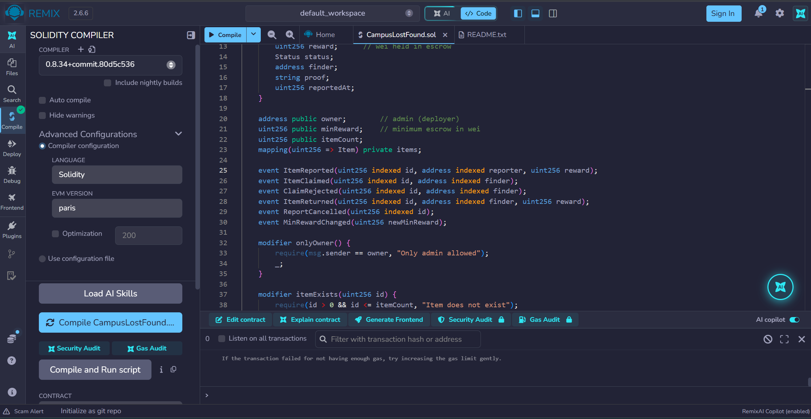

**Smart contract deployment** (Ganache: contract creation, address `0x46739c...4b399`)
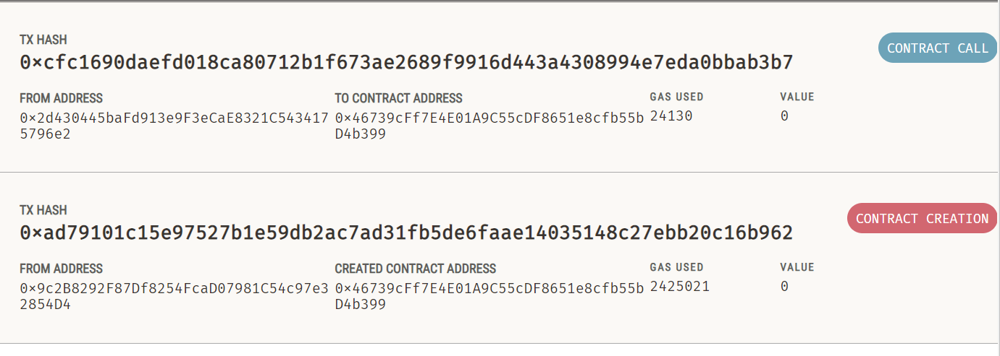

**MetaMask wallet connection and successful transaction** (account, chain ID 1337, contract loaded, report confirmed)
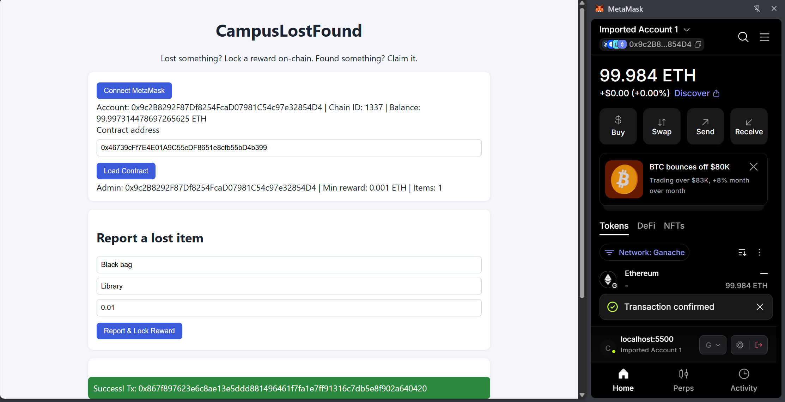

**Blockchain data displayed through the user interface** (item #1 read from the contract, status Open)
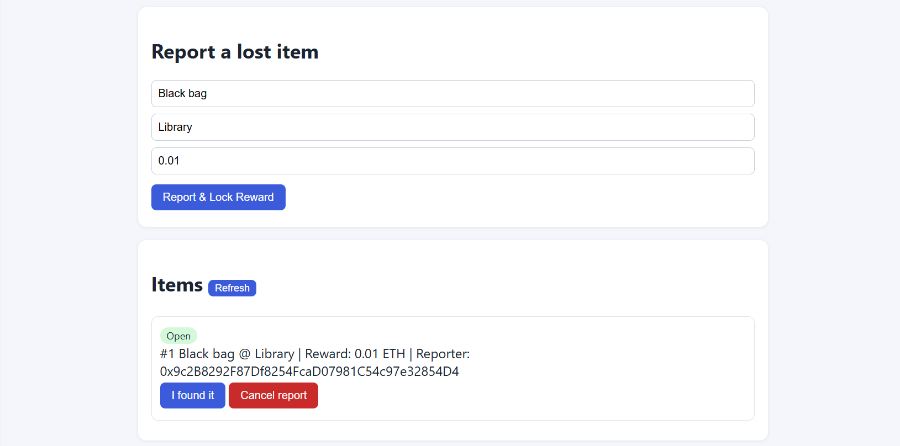

**Claim by Finder B (status Claimed)**
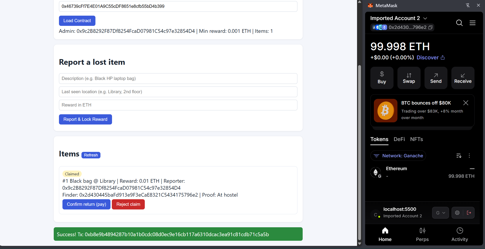

**Confirm return by Owner A (status Returned, successful transaction)**
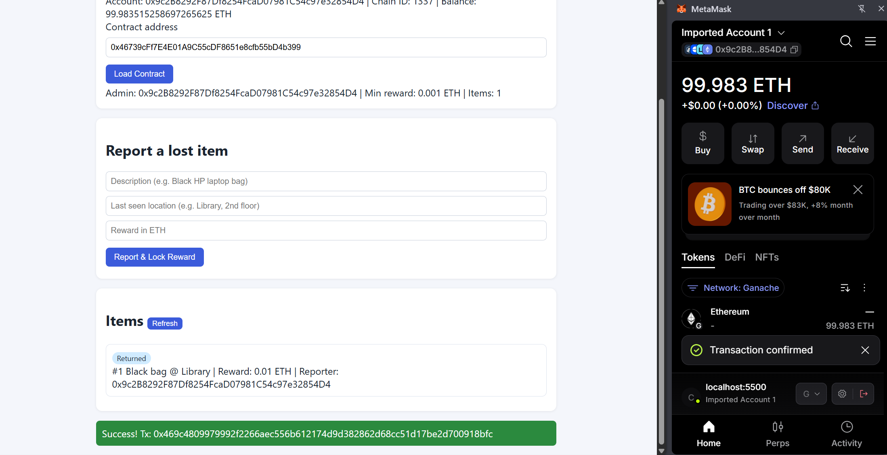

**Reward payout received by Finder B (100.008 ETH)**
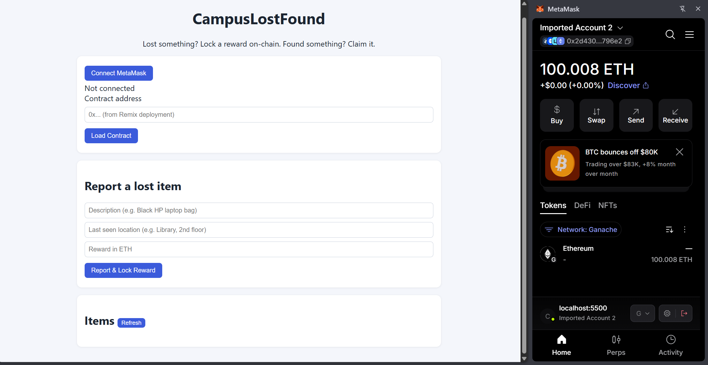

**Valid cancel with refund (status Cancelled)**
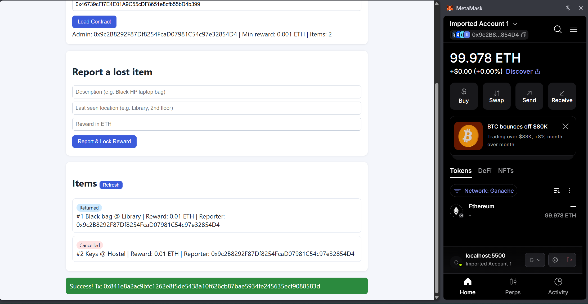

**Failed transaction - invalid input: empty description**
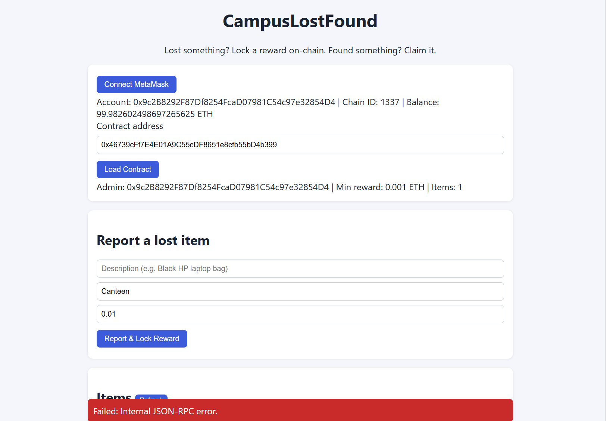

**Failed transaction - invalid input: reward below minimum**
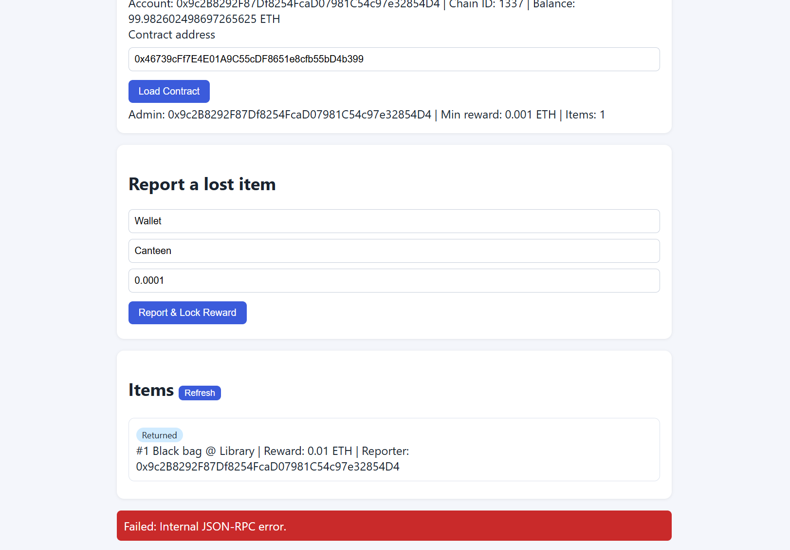

**Failed transaction - invalid input: non-existent item (Remix)**
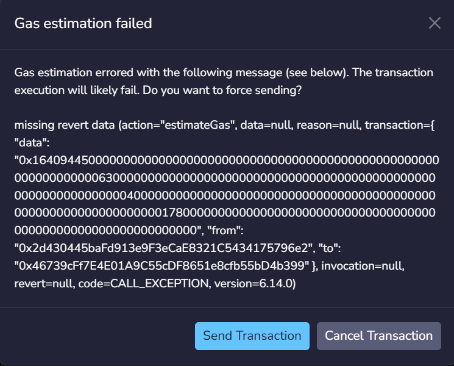

**Failed transaction - unauthorised: non-admin calls `setMinReward` (Remix)**
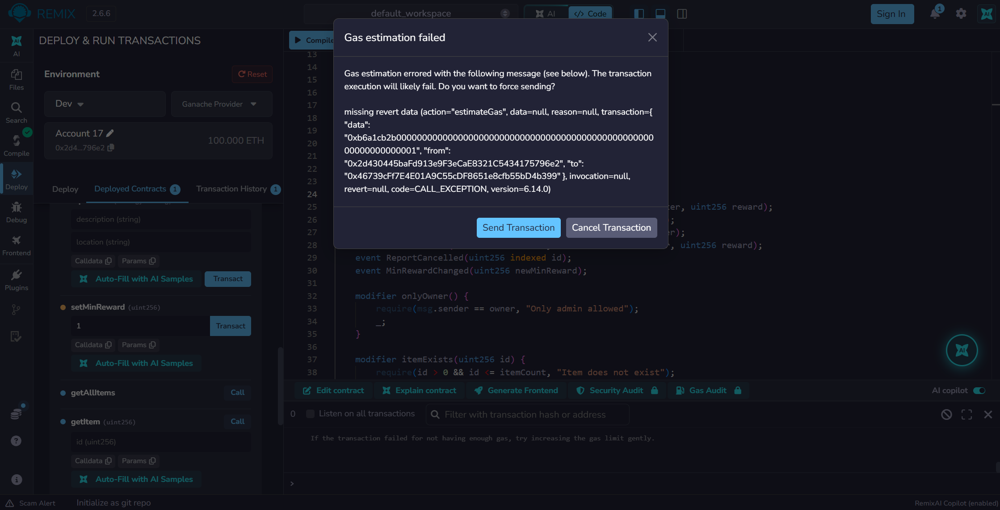

**Failed transaction - unauthorised: non-reporter cancels a report**
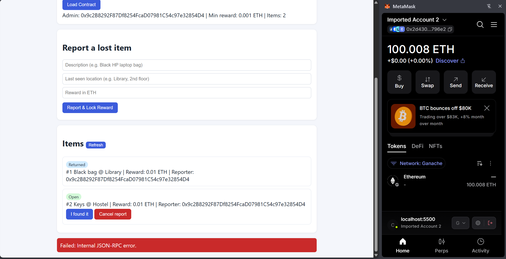

## 9. Security notes
- No private keys, seed phrases or passwords are stored in this repository. The Ganache accounts used are local test accounts only.
- State changes happen before ETH transfers in `confirmReturn` and `cancelReport`.
- The frontend writes user-provided text with `textContent` rather than `innerHTML`.
